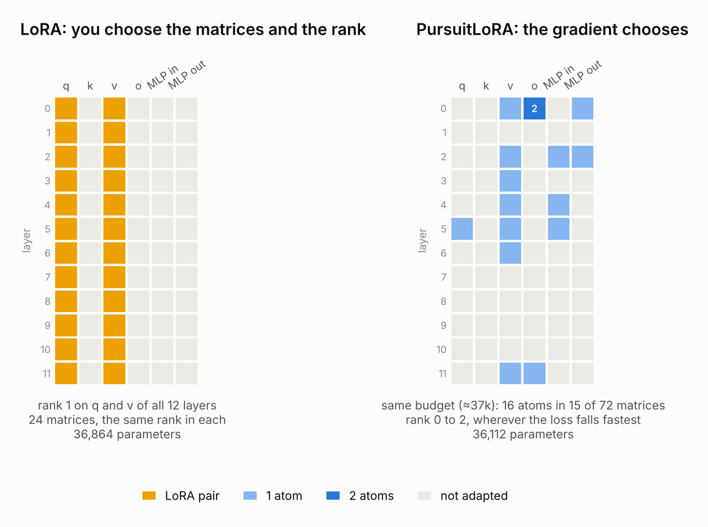
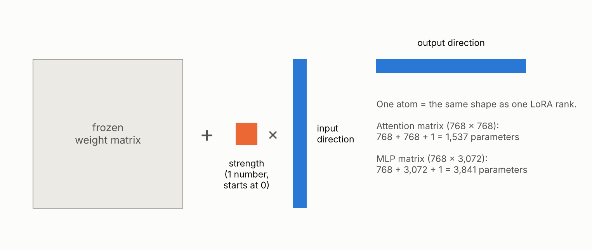
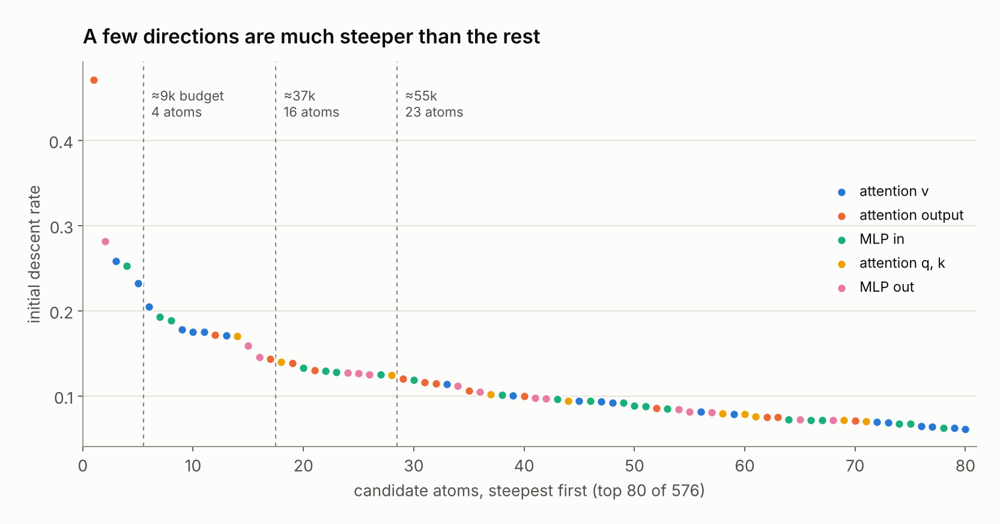
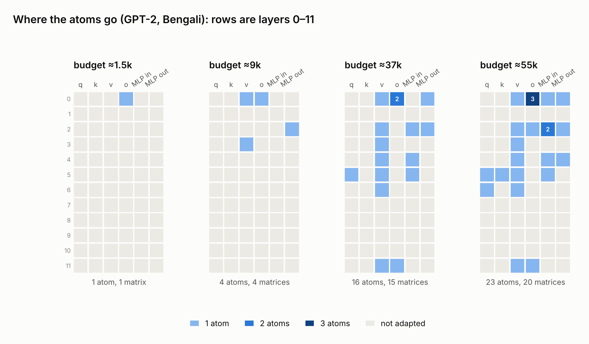
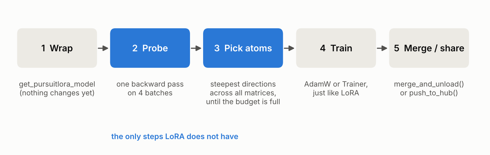
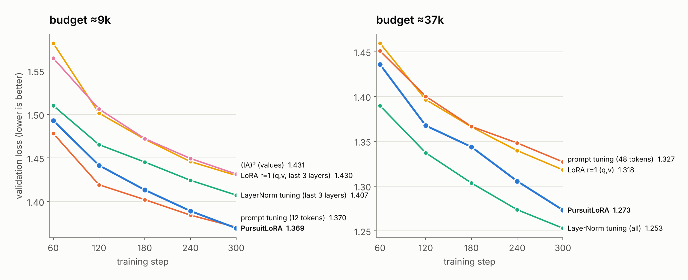
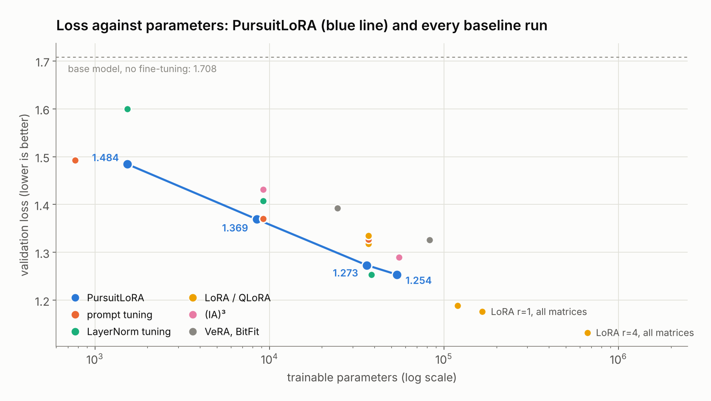
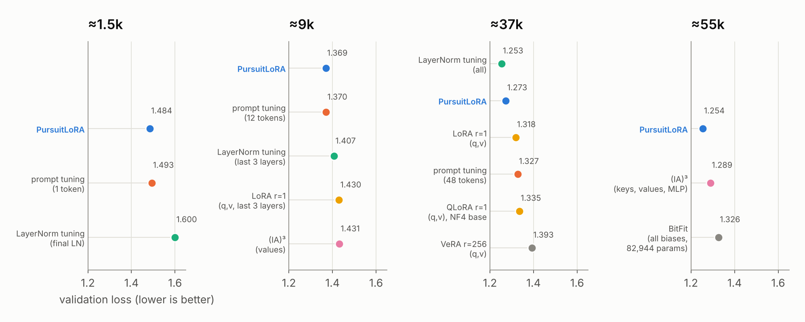
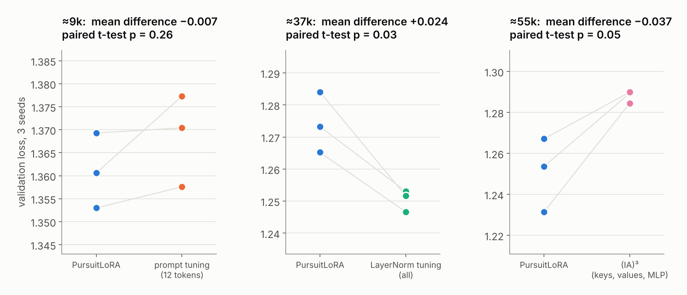
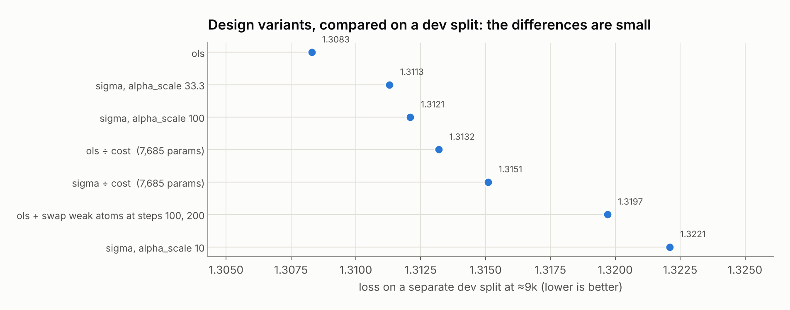

# PursuitLoRA: let the gradient decide where LoRA goes

*Gradient-pursuit adapters, explained with pictures*

Fine-tuning a large language model normally means changing millions of numbers. Parameter-efficient fine-tuning (PEFT) changes only a small, carefully chosen set, and LoRA is the best-known way to do it. PursuitLoRA keeps LoRA's shape but changes how the budget is spent. LoRA asks you which matrices to adapt and at what rank. PursuitLoRA lets the gradient decide.

At small budgets, from about 1,500 to 55,000 trainable parameters on GPT-2, that choice matters. PursuitLoRA beat LoRA at every budget where LoRA fits. Against all the other methods we tried (prompt tuning, LayerNorm tuning, (IA)³, VeRA, QLoRA and BitFit), it was the best at the smallest and largest of these budgets. It tied for first at about 9,000 parameters, and came second to LayerNorm tuning at about 37,000.

* **Code:** [github.com/AngshulMajumdar/PursuitLoRA](https://github.com/AngshulMajumdar/PursuitLoRA)

## The idea in one picture



A transformer is a stack of layers, and each layer has the same kinds of weight matrices: the attention projections q, k, v and o, and two MLP matrices. GPT-2 has 72 of them.

With LoRA you make two decisions up front: which of those matrices to adapt, and the rank to give each one. A common choice is q and v in every layer, with the same rank everywhere. Nothing in that recipe looks at your data.

PursuitLoRA makes both decisions from the data. With the same budget as rank-1 LoRA on q and v (about 37,000 parameters), it adapted 15 matrices instead of 24. It gave one matrix two directions instead of one, and left the other 57 matrices alone.

## Atoms: one LoRA rank at a time



PursuitLoRA builds its update from **atoms**. An atom has exactly the shape of a single LoRA rank:

* an **input direction**: what the change listens to,
* an **output direction**: what it writes back,
* a **strength**: one number, which starts at zero.

A matrix with three atoms is a rank-3 LoRA update. A matrix with no atoms is not touched at all. The budget is simply the total number of numbers in all the atoms.

## Where do the atoms come from?

Before training, PursuitLoRA runs **one gradient probe**: a backward pass on a few batches of your data. For every weight matrix, the gradient says which way the loss wants it to move. Each matrix's gradient is split into its strongest rank-one directions. Every such direction is a candidate atom, and it comes with a number: how fast the loss starts to fall if you move along it.



All candidates from all matrices go into one pool and are sorted by that number. PursuitLoRA takes them from the top until the budget is full. This is the "gradient pursuit" in the name. An atom in an MLP matrix costs two and a half times as much as one in an attention matrix, so near the end of the budget a cheaper atom can be taken in place of an expensive one that no longer fits.

The steepest direction on this task, in the attention output of the first layer, is about 1.7 times as steep as the next. That is why a handful of well-chosen atoms goes a long way.

## Where the atoms go



Two patterns stand out:

* **The first layers matter most.** The first atom always lands in layer 0. Most of the rest go into layers 0 to 6.
* **v gets atoms early; q and k come late.** The value projection of many layers is chosen early on. q appears only from about 37,000 parameters, and k only at 55,000.

A fixed LoRA recipe cannot adapt like this. The same rank on q and v in every layer spends half the budget on q, and a third of it on layers 7 to 10, which the gradient did not choose at any of these budgets.

## The workflow is LoRA's, plus one step



The atoms start with zero strength, so the model is exactly unchanged when training begins. After the probe, training is completely ordinary: AdamW with a single learning rate, or the Hugging Face Trainer. When training ends, the adapter can be merged into the model, so inference costs nothing extra. Alternatively, it can be saved as a file of tens to a few hundred kilobytes.

```python
from transformers import AutoModelForCausalLM
from pursuitlora import PursuitLoRAConfig, get_pursuitlora_model

model = AutoModelForCausalLM.from_pretrained("gpt2")
model = get_pursuitlora_model(model, PursuitLoRAConfig(budget=9216))
model.init_atoms(train_dataloader)      # the one extra step
model.print_trainable_parameters()      # 8,452 trainable parameters

# ... train as usual (AdamW, learning rate 3e-3) ...

model.save_pretrained("my-adapter")     # or model.push_to_hub("you/my-adapter")
model = model.merge_and_unload()        # a plain model again
```

## The test: teach English GPT-2 to write Bengali

To compare methods fairly, we took GPT-2 (124 million parameters, trained almost only on English) and fine-tuned it on three million tokens of Bengali news. Every method saw exactly the same batches for the same 300 training steps. Methods were compared at matched budgets of about 1,500, 9,000, 37,000 and 55,000 trainable parameters. The score is the validation loss on held-out articles; lower is better.



At about 9,000 parameters, PursuitLoRA and prompt tuning finish level, well ahead of LayerNorm tuning, LoRA and (IA)³. At about 37,000 parameters, PursuitLoRA beats LoRA and prompt tuning, but LayerNorm tuning is better.

## Every method at every budget



The blue line is PursuitLoRA; every other dot is a baseline run. The smallest standard LoRA setting (rank 1 on q and v in every layer) already needs 37,000 parameters. Going smaller means dropping layers, which is what the 9,000-parameter LoRA in our test had to do. PursuitLoRA works with a single atom: 1,537 parameters.



## Is it luck? Three random seeds



We repeated the closest contests with three random seeds. Each seed changes both the probe batches and the training batches, so the atoms themselves can change.

* **About 55,000 parameters:** PursuitLoRA beat (IA)³ on all three seeds, by 0.037 on average.
* **About 9,000 parameters:** PursuitLoRA beat prompt tuning on all three seeds, but only by 0.007 on average. With three seeds, that is too small to call a clear win: treat it as a tie.
* **About 37,000 parameters:** LayerNorm tuning beat PursuitLoRA on all three seeds.

## Design choices we tested



We tried several variations at about 9,000 parameters, judged on a separate dev split rather than on the test articles:

* **Ranking rule.** Choosing atoms by orthogonal least squares (`ols`), which avoids picking atoms whose effects overlap, was slightly better than picking the steepest atoms first. The package offers both. The default is the steepest-first rule, because it is simpler and uses far less memory. In the full runs, the two rules were within 0.01 of each other at every budget.
* **Strength scaling.** The atom strengths are scaled so that one learning rate suits every parameter; a scale of 33.3 or 100 worked, 10 was too small.
* **Cost-aware ranking.** Dividing each atom's steepness by its cost favours the cheaper attention atoms. It did not help.
* **Swapping weak atoms.** Replacing the weakest quarter of the atoms during training made things worse.

## When to use PursuitLoRA

PursuitLoRA is designed for small budgets: many adapters per user or task, edge devices, or experiments where every trainable parameter counts. In our tests, rank-1 LoRA on most or all matrices (120,000 parameters and up) reached a lower loss than any method at these small budgets. If you can afford that many parameters, plain LoRA is a fine choice.

The evidence so far comes from one base model (GPT-2), one task (adapting to Bengali) and short training runs. Results on other models and tasks will be added as they become available.

PursuitLoRA has a sibling, [TensorPEFT](https://angshulmajumdar.github.io/TensorPEFT/). TensorPEFT applies the same gradient-pursuit idea to whole stacks of layers at once instead of to individual matrices.

## Try it

```
pip install git+https://github.com/AngshulMajumdar/PursuitLoRA
```

The repository includes tests for GPT-2, Llama, Qwen2, Mistral, Phi and Gemma, the benchmark script and all the data behind these figures.

*Angshul Majumdar, IIIT Delhi*
